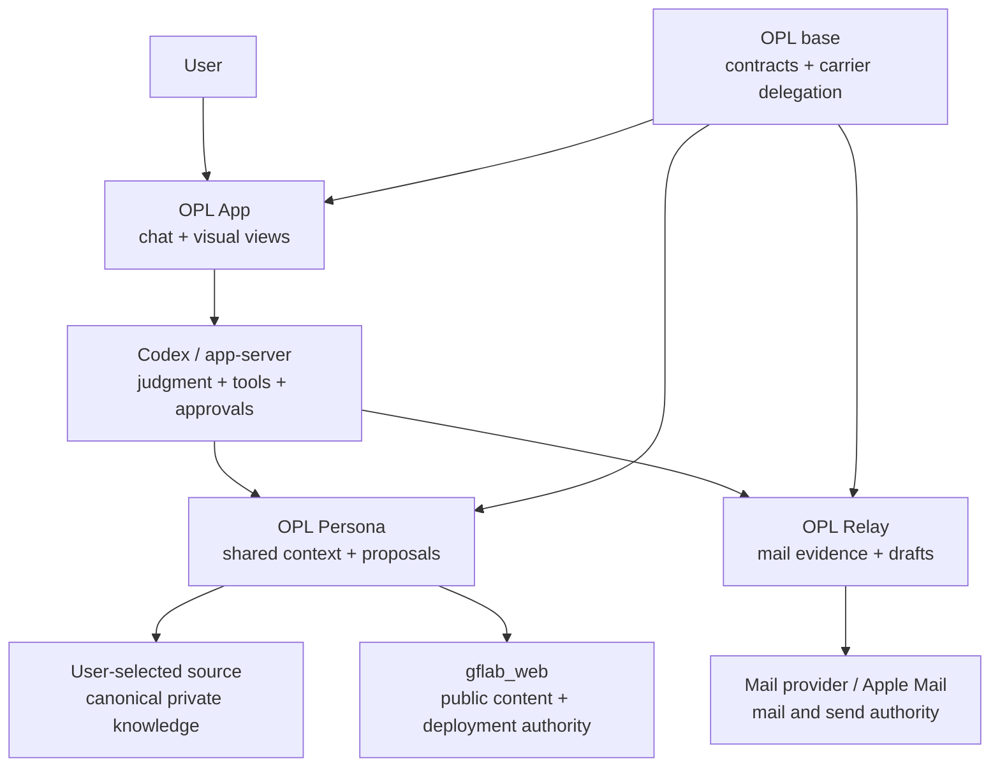

# OPL Personal Communication and Persona Architecture

Owner: `opl-persona`

Purpose: `persona_cross_repository_target_architecture`

State: `active_target_design`

Machine boundary: This document defines the intended cross-repository product shape, composable capability boundaries, and unimplemented target scope. Current Persona exports and callable behavior live in the Package descriptor, runtime source, tests, and [Persona Architecture](architecture.md); local resumable tasks and tool providers live in [External Professional Work](external-professional-work.md). Target capability and portal designs below do not make unexported schemas or adapters installed, callable, approved, or released.

## Product intent

OPL Persona is a personal communication and knowledge delegate: evidence from user-owned systems, source-bound derived context for continuity, user-selected canonical knowledge, and Codex for judgment and drafting.

Knowledge ownership, source bindings, and lifetime follow the [Framework knowledge source and memory policy](https://github.com/gaofeng21cn/one-person-lab/blob/main/docs/policies/knowledge-source-and-memory-policy.md). An existing Obsidian vault and an ordinary Markdown work directory share the same model. Persona adds cross-domain context without copying personal facts into another database or mediating other agents' knowledge access.

The user-facing product is **OPL App**, a chat-first host with visual surfaces for mail, memory, knowledge, proposals, and research; there is no separate Persona desktop shell.

```text
Package owners identity, capability/dependency intent, App contributions, publication
Native carriers physical install, update, repair, removal, and installed readback
OPL base       runtime, installed discovery, carrier delegation, aggregation, execution
OPL App        user-facing host, chat, navigation, views, approvals
```

OPL Framework owns the Host for runtime, Package graph, and App projection; Studio separately owns DSH profile/plugin/executor and delivery composition. They cooperate via public App state/action, authentication, and channel callbacks without sharing registries, sessions, or currentness. Codex CLI, Codex App, and `app-server` are execution surfaces, not domain authorities.

## System shape and repository authority



Arrows represent calls or proposal flows, not ownership transfer.

| Repository or system | Owns | Does not own |
| --- | --- | --- |
| `one-person-lab` | Generic Package contracts, installed discovery, carrier delegation, and aggregation | Package publication, carrier physical state, mail, Persona, website, or UI business state |
| `one-person-lab-app` | App product contract, page state, contribution consumption, acceptance | Domain data, mail semantics, website deployment |
| `opl-studio` | Current Desktop, WebUI and Docker App Shell; DSH/Cordis Application Host, native Codex and delivery composition | Framework Package graph or domain authority |
| `opl-relay` | Mail identities, evidence, relationship memory, draft lifecycle, send receipts | Persona orchestration, website CMS, Obsidian vault |
| `opl-persona` | PI context, provenance, cross-domain proposal shape, resumable task orchestration, and proposal state | Mail store, private vault, website source, credentials |
| `gflab_web` | Public publication/news source, Hugo build, deployment source | Private Persona state or mail state |
| User-selected knowledge source | Canonical private notes, technical memos, and personal profile values in Obsidian or ordinary files | Public website or mail delivery |
| Mail provider / Apple Mail | Mailbox and final send state | Persona proposal state |

App selects its current Shell via its [Shell adapter](https://github.com/gaofeng21cn/one-person-lab-app/blob/main/contracts/app-shell-adapter.json); [OPL DSH](https://github.com/gaofeng21cn/opl-dsh) independently enhances the official DeepSeek Harness desktop. Do not create separate repositories for a Relay UI, Persona UI, shared core, or per-adapter/per-site package unless independent release, permission isolation, or genuine cross-package reuse is proven.

## Composable capability and integration model

Mail, knowledge, websites, personal profiles, forms, portals, and Inbox are composable capabilities rather than a fixed product list:

| Object | Responsibility | Constraint |
| --- | --- | --- |
| Package | Installable unit of code and descriptors | Owner declares identity, dependencies, publication; native carrier owns physical lifecycle |
| Capability | Domain semantics guaranteed by a provider to consumers | Never equate UI pages, file paths, or install packages with semantic identity |
| Provider Adapter | Implements a capability and returns opaque action refs | Preserves external system authority; never takes over cross-domain judgment |
| Resource Binding | User-selected and authorized resource reference | Holds private refs, scopes, and policy; never copies secrets or source bodies |
| Persona Recipe | Composes capabilities and Bindings for a user role or workflow | Copies no code or data; never becomes a second runtime |

- One Package can provide multiple capabilities; one capability can have multiple providers; removing a Binding must not uninstall a provider or affect unrelated resources. Package removal, Binding removal, credential revocation, and external data deletion remain distinct operations.
- Exported capabilities (`knowledge.obsidian.v1`, `website.publication.v1`, `communications.mail.v1`, `personal.inbox.v1`, `personal.context.v1`, `personal.memory.v1`) and `knowledge.documents.v1` bindings follow [Persona Architecture](architecture.md). Candidate capabilities (`publishing.site.v1`, `personal.profile.v1`, `forms.fill.v1`, `external.portal.v1`) are target design only and do not expose callable actions until implemented.
- Providers expose only the operations they actually support (`inspect/health`, `read/search`, `propose`, `approved apply`, `readback`); a fresh probe establishes reachability and authorization scope rather than assuming health from installation.
- Recipes remain declarative combinations of discovered capabilities, installed providers, and configured Bindings (without hardcoding mail clients, site generators, vault paths, or journal portals); recipe registries and UI remain deferred until stable multi-role reuse demands them.

## Data and installation boundary

Code and private data stay physically separate:

```text
~/OPL/profiles/<user>/   # selected via OPL_PROFILE_WORKSPACE (default ~/OPL/profiles/<user>)
├── AGENTS.md
├── profile/             # source references or explicitly selected local notes
├── policies/            # optional local rules/templates, accepted before use
├── context/             # optional local project sources
├── templates/
├── exports/
└── data/
    ├── relay/           # mail, memory, draft and sync state (owned by opl-relay)
    └── persona/         # role refs, derived context, Inbox, proposals, bindings, tasks, receipts
```

A source checkout, installed plugin, Package cache, or task worktree is never a data authority. Private mail, raw EML, SQLite stores, relationship memory, Obsidian contents, credentials, cookies, and runtime cursors must never enter Git.

## Proposal-first mutation and domain boundaries

Every cross-system write flows through a reviewable `opl-persona-proposal.v1` (`approval.required=true`, `approval.external_write_allowed=false`) before an owning adapter executes the exact approved payload and reads back authority state:

```text
source evidence -> Persona context & provenance -> explicit proposal -> user review & approval -> owner adapter -> authoritative write -> fresh readback & receipt
```

- **OPL Relay**: owns IMAP sync, raw EML evidence, relationship memory, Apple Mail drafts, and send receipts; consumes Persona mail-context proposals without surrendering review or send authority. See [Mail Policy](mail-policy.md).
- **OPL Persona**: owns cross-domain context, provenance, Inbox capture staging, proposals, and resumable local task coordination. An approved proposal is never a completed write without owner execution and readback.
- **OPL App**: renders role-neutral `app_contributions` (`task_board`, `approval_diff`, `artifact_view`, `activity_log`) without special-casing `opl-persona` or persisting shadow domain approvals; see [App Integration](app-integration.md) and [Distribution](distribution.md).

### Target scope: personal profile, forms, and external portals

Current source already implements `personal.context.v1#tasks` (`task.prepare`, `task.run`, `task.check`) and local browser/desktop/GitHub/connector providers ([External Professional Work](external-professional-work.md)). What remains **unimplemented target design** is a typed personal-profile field catalog (`personal_profile` / `form_fill` Core, `personal-form-fill` Skill, `personal_field.v1` in [Personal Profile and Form Fill](personal-profile-form-fill.md)) and dedicated third-party academic/professional portal adapters (`external_work_item.v1`, `external_portal_profile.v1`, `external_action_receipt.v1`).

When implemented, external portal integration must preserve these boundaries:

- **Portal vs public site**: third-party editorial/review/society portals are external authorities, never `gflab_web` adapters or Relay workflows.
- **Auth & credentials**: default mode is `manual_session_only`; store only opaque refs (`identity_ref`, `browser_profile_ref`, `api_token_ref`) and role/scope policies in `<profile>/profile/access/sites/<site-id>.yaml`, never passwords, MFA codes, cookies, or full manuscripts/reviews.
- **Fail-closed & per-task approval**: third-party pages and manuscripts are untrusted evidence, never instructions. MFA, CAPTCHA, new terms, conflict declarations, layout drift, or task-identity mismatch must fail closed to the user; binding commitments (`accept_invitation`, `submit_review`, `invite_reviewer`, `make_editorial_decision`) always require per-task confirmation and third-party readback receipts.

## Change rules

Before adding a module or repository, verify:

1. Is this a new authority or a projection/adapter of an existing owner?
2. Can the current owner, native platform, or Package contract already handle it?
3. Does it create a second copy of private state or a second mutation path?
4. What exact approval, evidence, and authority readback prove completion?

Prefer the smallest owner-owned implementation; [Persona Architecture](architecture.md) owns current runtime surfaces, and this document does not maintain a duplicate implementation inventory.
